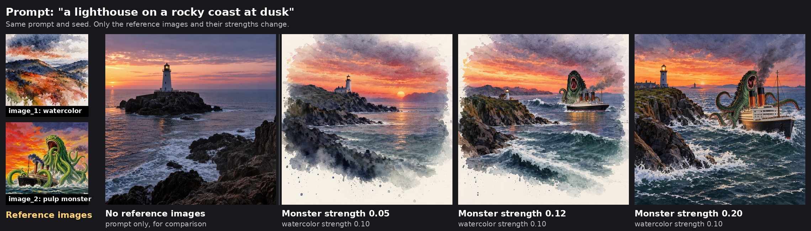

# ComfyUI-MOSSImagePrompt

A copy of ComfyUI's **Text Encode MOSS-Image Edit** node (no-VAE path) that gives **each reference image its own strength slider**, plus one for the prompt's words.



*The watercolor reference stays at 0.10 and sets the medium. Raising only the monster's strength brings its subject in, until at 0.20 it takes over and the watercolor fades.*

## Why

MOSS-Image's text encoder (Qwen3.5) is a vision-language model: give it images without a VAE and it reads them alongside your prompt. Each image becomes about **144 tokens**, while a prompt might be 10, so the images drown out your words. Core's single `image_strength` turns *all* images down together. This node lets you weight them separately and choose which one leads.

Base MOSS was never trained on reference images, so this works as a **semantic image prompt**, not a style copier. It carries over what's *in* the picture (subjects, themes, a vibe), usually rendered in MOSS's own look. Style transfers only when style is the image's dominant trait (e.g. a watercolor wash). Several images blend their concepts.

## Install

**Via ComfyUI-Manager:** "Install via Git URL" → `https://github.com/Dragon7108/ComfyUI-MOSSImagePrompt`

**Manual:**
```bash
cd ComfyUI/custom_nodes
git clone https://github.com/Dragon7108/ComfyUI-MOSSImagePrompt
```
Restart ComfyUI. No extra dependencies.

**Requires** a ComfyUI version that includes MOSS-Image's `context_attention_bias` (PR #17320, the one that added `image_strength` to the core node). On older versions the sliders silently do nothing.

## Example workflow

[`example_workflows/MOSS_Image_Prompt.json`](example_workflows/MOSS_Image_Prompt.json) reproduces the image above. It also shows up in ComfyUI's Templates browser under this pack's name.

1. Load it (drag the JSON onto the canvas, or open it from Templates).
2. Get the three model files from [Comfy-Org/MOSS-Image](https://huggingface.co/Comfy-Org/MOSS-Image): `moss_image_sft_int8_convrot.safetensors` (diffusion_models), `qwen3.5_9b_w4a8_gptq.safetensors` (text_encoders), `flux2-vae_small.safetensors` (vae). The loaders carry download links.
3. Drag `example_watercolor.jpg` and `example_pulp_monster.jpg` from `example_workflows/` into the two **Load Image** nodes (or copy them to `ComfyUI/input`).
4. Run, then move `strength_2` (the monster) and watch it come and go.

Both reference images were generated with MOSS-Image for this example.

## Usage

Use it in place of **Text Encode MOSS-Image Edit**, on the **positive** prompt:

```
Load CLIP (MOSS-Image text encoder) ─┐
Load Image ── image_1 ───────────────┼─ MOSS Image Prompt ── positive ── KSampler
Load Image ── image_2 ───────────────┘
```

Keep the negative on a plain **CLIP Text Encode**: with no VAE there are no reference latents for the negative to mirror. There's no VAE input.

Found under `model/conditioning/moss_image`, next to the core node.

## Settings

| Input | Default | What it does |
|---|---|---|
| `prompt` | | Your text prompt. |
| `text_strength` | 1.0 | Weight of the prompt's words. Above 1 (2–3) lets the words push back against the images. |
| `vision_size` | 384 | Each image is downscaled to at most this many pixels squared before the encoder reads it (core uses 384). Bigger = more tokens = more detail and more pull; lower its strength to match. |
| `image_1`…`image_4` | | Optional reference images. Only the first frame of a batch is used. |
| `strength_1`…`strength_4` | 0.05 | Each image's weight. **1** = unweighted (swamps the prompt), **~0.01–0.05** = a hint (the sweet spot), **0** = image left out. |

The **`info`** output (wire it to a Preview Any) lists each image's token count and bias, the prompt's, and the template's. Images are numbered `Picture 1, 2, …` in the order they're used, so with `image_1` left out, `image_2` becomes Picture 1; `info` shows both.

**Tips:** start images around 0.02–0.05 and nudge from there. Strengths are relative multipliers, not percentages: compare two images' strengths directly, and use `text_strength` to balance images against text. The numbers above are typical observations, not guarantees; results depend on the image.

## Limitations

- **Combine is fine, Concat is not.** `Conditioning (Combine)` and timestep-range nodes keep the bias working. `Conditioning (Concat)` lengthens the tokens but not the bias, so the sampler fails with a shape error (or, with this node on the `conditioning_from` side, the bias is silently dropped). Core's own node has the same limitation.
- **No `(word:1.2)` weighting.** MOSS's text encoder reads parentheses as literal text; `text_strength` is the only text weighting here.
- **Don't supply your own chat template.** Prompts starting with `<|im_start|>` bypass MOSS's template and aren't supported.

## How it works

ComfyUI's MOSS-Image model accepts `context_attention_bias`: one value per conditioning token, added to that token's attention logits in the diffusion model. Core's node puts `log(image_strength)` on every vision token. This node fills the bias per segment instead: `log(strength_i)` on image *i*'s tokens, `log(text_strength)` on the prompt's words, and 0 on the chat template and the `Picture N:` labels. At matching settings it builds the same inputs as the core node, and in testing the renders were pixel-identical.

## License

[GPL-3.0](LICENSE) — ComfyUI is GPL-3.0 and this node imports its APIs, so it matches the ecosystem.
